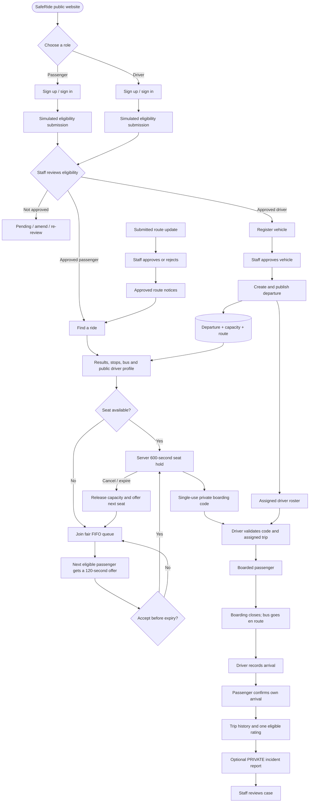
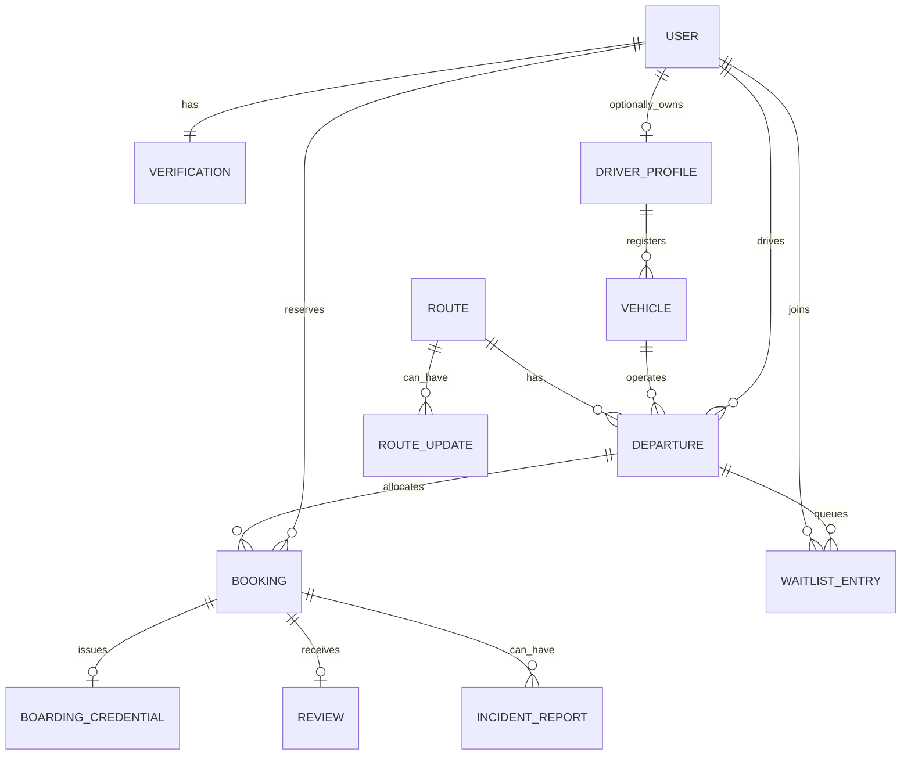

# SafeRide — End-to-End User Flow & Integration Map
**Checked 15 October 2026.** This is the design intent plus what has actually been verified in the repository.

## The whole journey

The booking window (600 seconds), queue offer (120 seconds), seat limits and one-time boarding checks are enforced in Django/PostgreSQL. Browser timers are display only. Driver arrival and passenger confirmation are separate events.

## Database relationships

## What is connected *today*?
| Layer | Verified | Gap |
|---|---|---|
| Frontend feature implementation | 13 feature PRs contain templates, CSS, JS and isolated tests | All PRs remain drafts/unmerged |
| Vercel visual preview | Site navigation and fictional page contexts are deployed | GET-only visual preview; no live booking |
| Django backend on main | Real registration, verification, vehicle, departure, booking, waitlist, check-in, safety views/services exist; [latest main CI passes](https://github.com/saferide-l2e/saferide/actions/runs/38701972329) | Full user journey/browser tests not yet verified |
| Database | Core Django models/migrations for users, vehicles, departures, booking, credentials, waitlist, feedback | Confirm deployed PostgreSQL settings, migrations and race tests |
| Integration | [FE integration PR #63](https://github.com/saferide-l2e/saferide/pull/63), [visual preview PR #65](https://github.com/saferide-l2e/saferide/pull/65) | Merge compatible templates and match Django views/contexts/routes |

## GitHub board status and source-of-truth rules
FE issues [#27–#39](https://github.com/saferide-l2e/saferide/issues?q=is%3Aissue%20label%3Ateam%3Afrontend) are OPEN. Their 13 feature PRs [#51, #52, #53, #54, #55, #56, #57, #58, #59, #60, #61, #62, #64](https://github.com/saferide-l2e/saferide/pulls) are all draft/unmerged as of the check.

Do not confuse code-complete UI with integrated product functionality. GitHub Project Status is separate from issue state: manually set **FE issues to In Progress** while backend wiring remains, feature PR cards to **In Review** after converting drafts to review-ready, and **Done** only when merged plus tested end to end. A filtered view with 26 entries likely tracks both 13 issues and 13 PRs.

## Integration acceptance checklist
1. Reconcile template names/context variables and URL routes with the Django views on main. Keep functioning BE code.
2. Merge FE foundation first, then review remaining stacked PRs and resolve conflicts against current main.
3. Configure PostgreSQL; migrate and load fictional sample accounts/vehicles/routes. Never represent sample checks as official ID screening.
4. Test permission gates and two-sided staff review; vehicle staff approval and departure publishing.
5. Test last-seat races, 600-second holds, expiry/cancellation, 120-second FIFO offers, single-use check-in, driver vs passenger arrival, history and one rating.
6. Confirm private incident reports never become public and only staff-approved route notices appear.
7. Test 360px, 390px, 768px and 1440px viewport sizes; keyboard, zoom, screen readers and low bandwidth.
8. Deploy the integrated app only after staging end-to-end tests pass; no false claims of real GPS or emergency dispatch.

[Board](https://github.com/orgs/saferide-l2e/projects/1/views/1) • [Frontend PRs](https://github.com/saferide-l2e/saferide/pulls) • [Team docs](https://github.com/saferide-l2e/saferide/blob/main/docs/TEAM_HUB.md)
