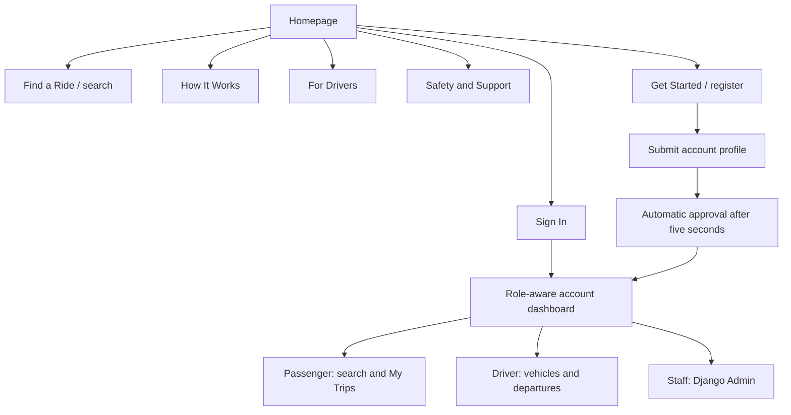
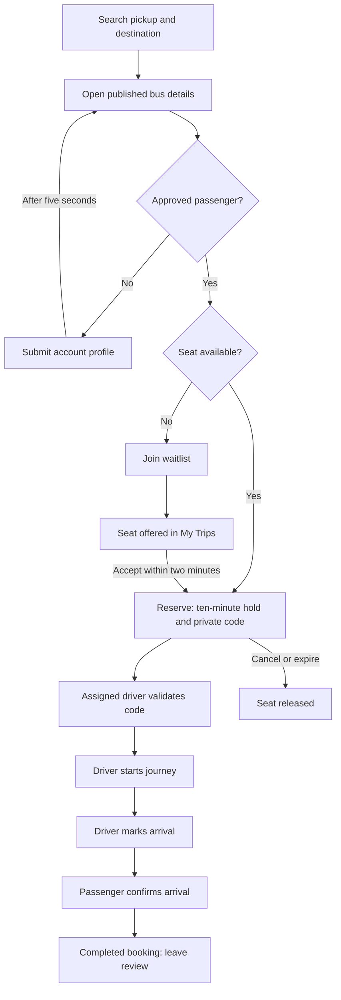
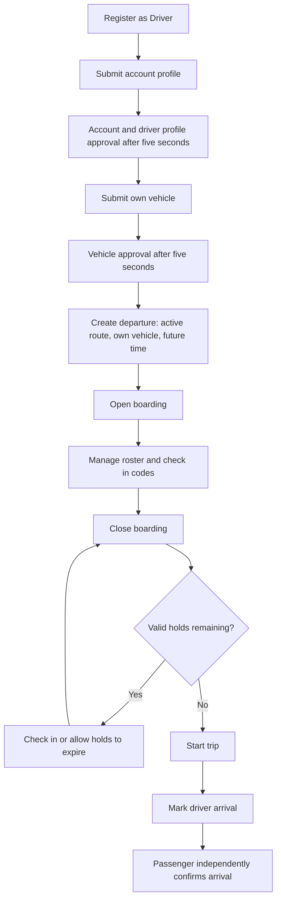

# SafeRide — Page and Workflow Map

**Version:** 1.0 · **Prepared:** 16 October 2026  
**Product:** SafeRide · **Audience:** product, design, engineering, operations and QA  
**Website:** <https://saferide-friday-web.onrender.com/>  
**Implementation baseline:** `94df60ce21fe1a0503e3fdf9fc6538e74a7aba0f` (PR #83)

## 1. Purpose and scope

This document maps the implemented website: where each journey starts, which page/action comes next, what the server changes, who may perform it, and how failures are handled. It covers **all 39 application routes**, the registered Django Admin modules and the separate internal preview area.

The baseline commit was confirmed through the live `/static/release.json` on 16 October 2026. Eight public pages were also opened read-only in Chromium. Private workflows below were mapped from URL configuration, views, services, templates and existing test evidence. They were **not re-executed against production accounts or the production database** for this documentation task.

Use this map for the current page connections and five-second approval policy. Earlier handoffs describing staff-only onboarding, a moving map bus or unimplemented foundations do not describe this release. This is a record of current behavior; the gaps in section 12 are not claimed as completed features.

## 2. Roles and access

| Actor | Can do | Main boundaries |
|---|---|---|
| Visitor | Read public pages, browse routes and published search results, open external road directions, register or sign in | Passenger bus details, private bookings, driver tools and account submission require authentication/role access |
| Passenger, profile not approved | Sign in, view dashboard/account status, submit profile, browse search and passenger bus details, file a private report | Cannot reserve seats or join the waitlist until account approval |
| Approved passenger | Reserve one seat, join a full departure's queue, accept an offer, see own boarding code, confirm arrival, review a completed booking, submit route observations | Cannot manage departures, view another passenger's booking or check passengers in |
| Driver | Complete account setup, maintain own driver profile, manage own vehicles/departures and passenger roster | Vehicle registration requires approved account access; departure creation requires an owned approved vehicle; management is limited to assigned departures |
| Staff | Use permitted Admin modules, override review decisions, moderate private incidents/route posts, inspect audits | Public signup never grants staff/superuser status; Admin model permissions apply to ordinary modules |
| Automatic review processor | Approve eligible pending account, driver-profile, vehicle and route-post records after five seconds | Does not approve unsubmitted accounts, change user roles, override rejected/suspended records or resolve private incidents |

**Approval means application access/listing permission.** It is not email ownership verification, a government identity check, a licence check, a background check, a vehicle inspection or a safety guarantee.

## 3. Site navigation and primary connections

| Location/state | Navigation and destinations |
|---|---|
| Public header | Logo → `/`; Find a Ride → `/departures/search/`; How It Works → `/how-it-works/`; For Drivers → `/for-drivers/`; Safety & Support → `/safety-support/`; Sign In → `/accounts/login/`; Get Started → `/accounts/register/` |
| Signed-in passenger header | Find a Ride → search; My Trips → `/bookings/`; Route Updates → `/safety/route-updates/`; Account → `/verification/`; sign out via POST |
| Signed-in driver header | Dashboard → `/departures/driver/`; My Vehicles → `/driver/vehicles/`; Departures → `/departures/driver/new/`; Account → `/verification/`; sign out via POST |
| Common account dashboard | `/dashboard/` shows passenger, driver or staff cards; staff panel takes precedence over the selected passenger/driver role |
| Footer | Search, My Trips, driver signup, driver dashboard, safety/support, community route updates and private-report entry |
| Theme/menu | Light/dark preference is stored locally; mobile menu exposes the same role-based links; theme changes do not alter permissions or data |

The footer can link to a role-restricted destination. Visitors are asked to sign in; a signed-in user with the wrong role receives access denial. Staff have an Admin card on the common dashboard, not a separate public staff navigation system.

## 4. Complete route and page catalogue

`{departure_id}`, `{booking_id}` and `{entry_id}` below are UUIDs. Methods describe the normal UI workflow: a POST-labelled action is explicitly POST-only; a GET-labelled page is read via GET, but some read views do not explicitly reject every other HTTP method. All state-changing HTML submissions use CSRF protection.

### 4.1 Public information and shared account landing

| Page | Route | Access | Main action / next destination |
|---|---|---|---|
| Homepage | `GET /` | Public | Hero CTAs and quick origin/destination search → search results; secondary road-map preview; driver signup and product-information links |
| How It Works | `GET /how-it-works/` | Public | Registration, profile submission, search and My Trips |
| For Drivers | `GET /for-drivers/` | Public | Register with `?role=DRIVER`; open driver dashboard |
| Safety & Support | `GET /safety-support/` | Public | Account status, route notices, My Trips and private incident reporting |
| Account dashboard | `GET /dashboard/` | Signed in | Role-aware shortcuts; passenger completed-ride count and earned progress, driver vehicle/departure tools, staff Admin link |

The homepage uses an original static Lagos poster unless all four configured cinematic video encodes exist. A video-ready component does not mean final bridge/boarding footage is installed. Search suggestions link to searches; they do not create departures or guarantee seats.

### 4.2 Registration, sign-in and profile approval

| Page / action | Route | Access / inputs | Result / next destination |
|---|---|---|---|
| Register | `GET/POST /accounts/register/` | Visitor; display name, email, Passenger/Driver, password and confirmation | Valid account → signed in automatically → `/verification/`; invalid details remain on form |
| Sign in | `GET/POST /accounts/login/` | Visitor; email and password | Valid active account → `/dashboard/`; generic error on invalid credentials |
| Sign out | `POST /accounts/logout/` | Session action | Ends session → homepage; GET is not a logout action |
| Account summary | `GET /accounts/profile/` | Signed in | Read-only name/role summary → account approval status |
| Approval/profile page | `GET /verification/` | Signed in | Show own status, profile form when permitted, progress notice or approved continuation → `/dashboard/` |
| Submit/update profile | `POST /verification/submit/` | Signed in; two required declarations; optional display name, area and preferred stop | New request → PENDING; pending-profile update saves details; redirect → `/verification/` |

### 4.3 Route discovery and passenger bus details

| Page | Route | Access / inputs | Result / next destination |
|---|---|---|---|
| Route directory | `GET /routes/` | Public; optional `origin`, `destination` | Active database routes → route-specific departure search |
| Find a bus/results | `GET /departures/search/` | Public; `origin`, `destination` | Matching published departures, eligibility guidance or empty state → bus detail |
| Bus/departure detail | `GET /departures/{departure_id}/` | Active passenger account; approval not required merely to view | Route, vehicle, permitted driver information and current capacity → reserve, waitlist, existing reservation or account status |
| Illustrative itinerary | `GET /departures/sample-ride/` | Public; origin/destination and `option=1..4` | Read-only example itinerary; no real Departure or reservation is created |

Production search does not inject illustrative departures: the search preview switch requires `DEBUG` and `preview=1`. The standalone illustrative-itinerary URL still exists and must not be mistaken for a bookable service.

### 4.4 Driver pages and departure actions

| Page / action | Route | Access / inputs | Result / next destination |
|---|---|---|---|
| My vehicles | `GET /driver/vehicles/` | Active driver | Own vehicle list and statuses; pending approvals update automatically; Add a vehicle |
| Add vehicle | `GET/POST /driver/vehicles/new/` | Driver; approved account to submit; plate, vehicle type, positive capacity | New vehicle → PENDING → My vehicles; otherwise approval guidance or field errors |
| Driver profile | `GET/POST /driver/vehicles/profile/` | Active driver; public display name and bio | Update own driver profile → same page |
| Driver departures dashboard | `GET /departures/driver/` | Active driver | Own schedules, vehicle counts and boarded totals → create/manage departure |
| Create departure | `GET/POST /departures/driver/new/` | Approved driver account; own approved vehicle, active route, future departure time | Valid input → DRAFT departure → manage page |
| Manage departure and roster | `GET /departures/driver/{departure_id}/manage/` | Assigned active driver | Current state, roster, lifecycle controls and boarding-code forms |
| Change departure state | `POST /departures/driver/{departure_id}/transition/` | Assigned driver; `action` | Publish, close boarding, start, mark arrived or cancel → manage page |
| Check in passenger | `POST /departures/driver/{departure_id}/check-in/` | Assigned driver; `booking_id`, private `code` | Valid unused code and live hold → BOARDED → manage page; failure shows error or access denial |

There are no public vehicle edit/delete routes, separate driver-history route or independent roster page in this release. Roster/check-in are part of the manage page. Several similarly named design templates exist only in the preview area.

### 4.5 Passenger bookings and waitlist actions

| Page / action | Route | Access / inputs | Result / next destination |
|---|---|---|---|
| My Trips | `GET /bookings/` | Active passenger | Own reservation history and offered waitlist seats → reservation detail or accept offer |
| Reservation / boarding pass | `GET /bookings/{booking_id}/` | Owning active passenger | Hold countdown, permitted code display, status, cancellation or arrival/review actions |
| Reserve one seat | `POST /bookings/departures/{departure_id}/reserve/` | Approved passenger and bookable departure | HELD booking + single-use code → reservation detail; business-rule failure → departure detail |
| Cancel reservation | `POST /bookings/{booking_id}/cancel/` | Passenger route; service checks ownership/authorized actor | Active booking → CANCELLED; release capacity → reservation detail |
| Join waitlist | `POST /bookings/departures/{departure_id}/waitlist/` | Approved passenger; full departure open for boarding | WAITING entry → departure detail |
| Accept seat offer | `POST /bookings/waitlist/{entry_id}/accept/` | Owning passenger; live offered entry | ACCEPTED queue entry + new HELD booking/code → reservation detail; failure → My Trips |
| Confirm passenger arrival | `POST /bookings/{booking_id}/confirm-arrival/` | Owning passenger; driver must have marked arrival | Eligible boarded booking → COMPLETED → detail with review link |

### 4.6 Reviews, private reports and community route notices

| Page / action | Route | Access / inputs | Result / next destination |
|---|---|---|---|
| Rate a journey | `GET/POST /safety/reviews/{booking_id}/` | Owning passenger; completed booking; stars 1–5 and optional comment | One review per booking → reservation detail |
| General private report | `GET/POST /safety/reports/` | Signed in; category and description | Private incident record → account dashboard |
| Trip-specific private report | `GET/POST /safety/reports/{booking_id}/` | Passenger or assigned driver involved in that booking | Private incident record, linked to trip/other party → My Trips |
| Community route feed | `GET /safety/route-updates/` | Public | APPROVED route observations with timestamps; signed-in user can open submission form |
| Share route observation | `GET/POST /safety/route-updates/new/` | Signed in; approved account to submit; route, type, note, occurred-at time | PENDING route update → feed → automatic publication after five seconds when eligible |

The feed's contribution link is shown to signed-in users, while the submission service additionally requires approved account access. Incident reports remain private and require staff follow-up. They are not automatically marked reviewed/resolved, are not public allegations and do not trigger emergency dispatch.

### 4.7 Supporting JSON endpoints

| Endpoint | Access | Purpose and boundary |
|---|---|---|
| `GET /review-progress/` | Signed in | Own account/profile/vehicle/pending-route-post version; read-only and non-cacheable; never grants approval |
| `GET /health/` | Public | Returns application health response; does not by itself prove database, worker or complete product readiness |
| `GET /departures/{departure_id}/availability/` | Active passenger | Current departure state, capacity and available seats; no reservation is made |
| `GET /bookings/{booking_id}/status/` | Owning active passenger | Booking status, expiry, remaining seconds and check-in timestamp; read-only |

`/static/release.json` is a generated build-identity asset, not a separate Django page. It identifies the deployed commit and contains no deployment credentials.

### 4.8 Internal design preview and error pages

The preview area is enabled only when both development `DEBUG` and `SAFERIDE_VISUAL_PREVIEW` are enabled. It is not a production customer flow. Its GET-only views use example context and do not create accounts, reservations, approvals or check-ins.

| Preview entry | Purpose |
|---|---|
| `/preview/` | Internal review homepage |
| `/preview/screens/` | Design gallery/index |
| `/preview/how-it-works/`, `/preview/drive/`, `/preview/support/`, `/preview/my-trips/` | Internal public-page/history presentations |
| `/preview/{slug}/` | One of the 25 template presentations listed below |

The 25 supported slugs are: `search`, `results`, `bus-detail`, `route-updates`, `reservation`, `queue`, `offer`, `trip`, `history`, `review`, `register`, `login`, `verification`, `passenger-profile`, `driver-profile`, `report`, `contribute`, `driver-dashboard`, `vehicles`, `register-vehicle`, `publish-departure`, `departure-detail`, `roster`, `boarding`, and `driver-history`.

The same template can be reused by a real page and a preview. A preview screenshot alone does not establish that its controls have a production endpoint.

No custom top-level 403/404/500 templates were found. Legitimate wrong-role, cross-user, invalid-CSRF and missing-object failures can therefore fall back to Django's standard error response. The vehicle-onboarding approval guidance is a specific handled case, not a replacement for all application error pages.

## 5. Account onboarding and five-second approval

### 5.1 Registration through approved account

1. Visitor chooses Passenger or Driver. `/accounts/register/?role=DRIVER` preselects Driver; it does not grant staff rights.
2. Server validates the form. Email is trimmed/lowercased and must be unique. Password must have at least eight characters and match its confirmation.
3. Successful registration saves a hashed password, creates an unsubmitted account-review record, opens a session and redirects to `/verification/`.
4. User supplies the requested profile details and confirms both declarations. Name, area and preferred stop are optional; declarations are required.
5. A valid submission becomes PENDING and records its server submission timestamp. Missing declarations return HTTP 400 with form feedback; no approval request is created.
6. The processor approves an active pending account once at least five seconds have elapsed. Driver submission also creates the driver-profile record needed by the driver workflow.
7. The pending page polls the private progress endpoint and refreshes after the status changes. The approved user can continue to the common dashboard.

| Account state | What the user sees/can do | How it changes |
|---|---|---|
| NOT_SUBMITTED | Profile form; no restricted booking access | Submit valid declarations → PENDING |
| PENDING | Processing status; can browse; pending-profile details may be updated | Eligible timed processor → VERIFIED; staff may reject/suspend |
| VERIFIED | “Account approved” and continuation button | Staff may change status; role-specific rules still apply |
| REJECTED | Review note and resubmission form | Explicit new permitted submission → PENDING; no timer directly overrides rejection |
| SUSPENDED | Restricted-account message | No self-service resubmission; staff intervention required |

Signing up again with an existing email does not reset its password. Sign-in uses that account's exact normalized email and its saved password. There is no public password-reset/email-OTP flow in this baseline.

### 5.2 Automatic processing rules

| Queue | Deadline source | Additional conditions | Automatic result |
|---|---|---|---|
| Account profile | `submitted_at + 5 seconds` | PENDING, timestamp present, user active | VERIFIED; system audit and approval note |
| Driver profile | `created_at + 5 seconds` | PENDING profile, active Driver role, approved account | APPROVED profile |
| Vehicle | `created_at + 5 seconds` | PENDING, active approved driver account and approved driver profile | APPROVED vehicle listing |
| Route observation | `created_at + 5 seconds` | PENDING, active approved author, active route | APPROVED/public observation |

The worker scans every 250 ms using database timestamps and locked transactions. It runs independently of browser tabs. Rejected/suspended records are excluded. Existing overdue eligible work is picked up after restart. A pending account with no submission timestamp has no valid deadline and is not silently approved.

Five seconds is a minimum processing delay, not a guaranteed visible response time. Scheduling, a restart/sleeping server, network latency and the page refresh can add time. Polling is every 500 ms while visible; approval itself does not depend on JavaScript. Without JavaScript, refresh the page after the delay.

`SAFERIDE_AUTO_APPROVAL` defaults to true. If disabled, staff review remains necessary. Disabling automation does not undo approvals already committed. See [Five-second approval policy](FIVE_SECOND_APPROVALS.md) for operation and rollback details.

## 6. Passenger journey: search to completed trip

### 6.1 Search and select

- Enter two different stops and submit the GET form. Origin/destination parameters are preserved in the search URL.
- Search normalizes stops, matches route names without spaces/case differences, and returns at most 20 departures currently open for boarding and scheduled more than ten minutes ahead.
- Displayed seats subtract valid holds, boarded passengers, live waitlist offers and walk-ins from the departure's capacity snapshot.
- A route directory entry or map road route does not create a scheduled bus. No matching published departure means an empty result, not invented availability.
- Visitors can browse results but must sign in as a passenger to open a real departure detail page. The current login flow lands on the dashboard; it does not automatically restore the original deep link.
- Detail shows the assigned vehicle and permitted driver public profile/status. Unapproved driver bio is withheld; private email/contact documents are not shown.

### 6.2 Reserve and board

1. Passenger selects Reserve one seat. The server rechecks account eligibility, open boarding, departure lead time, capacity, duplicate seats and overlapping active trips under transaction locks.
2. Success creates one HELD booking expiring in 600 seconds and a six-digit single-use credential. There is no checkout or payment step.
3. Reservation detail displays the code from the issuing browser session, expiry and boarding instructions. The credential table stores a digest, not the plaintext code.
4. Passenger reaches the boarding point before expiry and privately supplies the code to the assigned driver.
5. Driver opens the assigned roster and submits the booking ID/code. Correct, unused code plus a live hold → BOARDED; credential is consumed.
6. Incorrect/used code, expired hold or wrong driver cannot complete check-in. A different passenger cannot view the reservation/code.

The original code is held in the issuing session. Signing out, clearing that session or switching devices may make the code unavailable for redisplay even though its booking remains. No code-reissue workflow is implemented.

### 6.3 Cancel, expire or change status

- A held passenger can use Cancel my reservation. The service releases the seat and advances eligible waitlist entries.
- Expired holds stop consuming displayed inventory based on timestamps. Persisting EXPIRED status and generating offers happen during inventory reconciliation, not in the countdown JavaScript.
- Driver cancellation of the departure cancels its held/boarded bookings and waiting/offered entries. It does not create an automatic refund workflow.
- Status polling updates the reservation message; refresh can be needed to reveal newly available arrival/review actions.
- My Trips is the passenger history/offer entry point. There is no separate production journey-tracker URL or live GPS tracking.

### 6.4 Arrival, review and earned progress

- Driver first records ARRIVED for the departure, stamping arrival on boarded bookings.
- Passenger independently confirms arrival on their booking. Only then does that booking become COMPLETED.
- Completed-booking detail exposes Rate this journey. One review per booking is allowed, with stars 1–5 and an optional comment.
- The passenger dashboard derives completed-ride count, ten displayed points per completed ride and a five-ride progress cycle from completed bookings. These are not cash, transferable balance or a redemption/payment feature.

## 7. Waitlist and offer workflow

| Step/state | Trigger | What happens next |
|---|---|---|
| WAITING | Eligible passenger joins a full open departure | One active entry per passenger/departure; queue order is joined time, then ID |
| OFFERED | Reconciliation detects a free seat and advances the queue | Seat is reserved for the offered passenger for 120 seconds; offer appears in My Trips |
| ACCEPTED | Owner accepts a live offered entry | New 600-second HELD booking and new private code; entry links to the new booking |
| EXPIRED | Offer deadline passes and reconciliation runs | Offer allocation is released; next eligible waiting entry can be offered the seat |
| INELIGIBLE | Advancing the waiting queue finds an ineligible passenger | That waiting entry is skipped |
| CANCELLED | Departure is cancelled | Waiting/offered entries are cancelled |

Joining does not guarantee a seat. A live offer consumes inventory so another passenger cannot normally take the allocated seat. Offers are surfaced in the application; no email, SMS or push-notification delivery is implemented.

The dedicated waitlist/offer design templates are not wired to standalone production routes. There is no public Leave waitlist endpoint in this baseline. Read-only polling does not run reconciliation. `python manage.py reconcile_departures` exists for scheduled maintenance, but its production schedule is not established by the repository start script; see section 12.

## 8. Driver journey: onboarding to arrival

1. Register with Driver selected, submit the account profile and wait for account/profile approval. Registration alone leaves the account unsubmitted.
2. Open My vehicles → Add a vehicle. If account access is not approved, the page links back to account status instead of presenting an unusable submission form.
3. Enter a unique plate display, vehicle type and positive seating capacity. Plate normalization removes spacing/punctuation differences for duplicate checks.
4. Submission creates a PENDING vehicle; eligible vehicle approval runs after five seconds. Rejected/suspended vehicles do not automatically become approved.
5. Create a departure using an active route and an owned approved vehicle. Enter a time more than ten minutes ahead; the form currently uses UTC, not Lagos local time.
6. The server creates a DRAFT and snapshots capacity from the vehicle. A draft is not discoverable as an open departure.
7. Open boarding on the manage page. The departure can appear in passenger search while its search-time conditions hold.
8. Use the assigned passenger roster to check boarding codes. Drivers cannot manage another driver's roster or check-ins.
9. Close boarding. Starting the trip is blocked while live held reservations remain unresolved.
10. Start trip → EN_ROUTE; mark driver arrival → ARRIVED. Passenger completion is a separate action on each booking.

Driver-profile editing updates the public display name/bio. Public driver details are shown only under the profile/account conditions in the presentation layer. There is no licence-document upload or actual screening workflow.

### Departure lifecycle

| Current state | Manage-page action | Result / important condition |
|---|---|---|
| DRAFT | Open boarding (`publish`) | BOARDING_OPEN |
| BOARDING_OPEN | Close boarding (`close_boarding`) | BOARDING_CLOSED; inventory is reconciled |
| BOARDING_CLOSED | Start trip (`start_trip`) | EN_ROUTE only after valid holds resolve |
| EN_ROUTE | Mark driver arrival (`mark_arrived`) | ARRIVED; boarded bookings receive driver-arrival timestamp |
| DRAFT / BOARDING_OPEN / BOARDING_CLOSED | Cancel departure (`cancel`) | CANCELLED; related active bookings/queue entries cancelled |
| ARRIVED / CANCELLED | No forward lifecycle controls | Terminal departure states |

The cancellation service also accepts EN_ROUTE cancellation, although the current manage-page button is hidden in that state. This is an implementation/UI mismatch, not an extra visible page action.

### Booking lifecycle

| State | Normal entry | Normal next step |
|---|---|---|
| HELD | Direct reservation or accepted queue offer | BOARDED on valid check-in; CANCELLED on cancellation; EXPIRED after deadline/reconciliation |
| BOARDED | Assigned driver's valid check-in | COMPLETED after driver arrival and passenger confirmation; cancellation service also accepts an active boarded booking |
| COMPLETED | Passenger confirms arrival | May leave one review; retained in history |
| CANCELLED | Reservation or departure cancelled | History; no active code |
| EXPIRED | Hold expired and reconciled | History; no valid seat/code |
| DISPUTED | Stored model/service-supported state | No dedicated customer dispute page/transition is wired; arrival-confirmation service supports this state, but the current visible button is shown only for BOARDED |

## 9. Safety and community workflows

### Private incident report

Signed-in user → Safety & Support or trip-report URL → category/description → save private PENDING incident → dashboard/My Trips → staff follows up in Admin.

Trip reports require the actor to be the booking's passenger or assigned driver. When linked to a trip, the service can identify the other party as the subject. General reports do not need a booking. Incident text is not published as a route notice or public allegation. The current interface has no reporter-facing case inbox, response thread, attachments or automated emergency dispatch.

Staff can mark an incident REVIEWED, RESOLVED or DISMISSED. Those actions record reviewer/time and audit metadata. A five-second account or post approval never means an incident was investigated or resolved.

### Community route observation

Approved account → share observation form → active route, Traffic/Safety type, note and occurrence time → PENDING → automatic publication after five seconds when eligible → public feed.

The feed only displays APPROVED posts, with route/type/time and escaped text. Automatically published observations are not independently verified facts or a live traffic feed. Rejected posts are excluded; staff retain explicit approve/reject actions. The passenger bus-detail view currently passes an empty route-notices list, so published feed observations are not yet integrated into individual departure details.

### Journey rating

Completed own booking → Rate this journey → one 1–5-star review → booking detail. The model/admin store reviews; a public aggregated driver-rating profile is not implemented.

## 10. Staff and administration workflow

Staff enter through `/dashboard/` → Admin, or directly `/admin/`. Django's Admin login/logout/password-management pages are separate from the passenger/driver account pages. Normal model access requires the relevant staff permissions; superusers have broader access. Public registration cannot create a staff account.

| Admin module | List route | Main available work |
|---|---|---|
| Users | `/admin/accounts/user/` | Account records, activation, roles, staff permissions and authorized password changes |
| Groups | `/admin/auth/group/` | Manage permission groups |
| Account reviews | `/admin/verification/verification/` | Inspect submitted profiles; named approve/reject/suspend actions with audit events |
| Driver profiles | `/admin/vehicles/driverprofile/` | Inspect/edit public profile and stored approval status; see action-registration gap below |
| Vehicles | `/admin/vehicles/vehicle/` | Inspect records; approve/reject selected vehicles through service actions |
| Routes | `/admin/routes/route/` | Maintain route labels, boarding/destination points and active state |
| Departures | `/admin/departures/departure/` | Inspect/edit schedules, states and walk-in counts under model permissions |
| Bookings | `/admin/bookings/booking/` | Inspect reservation status, dates and passenger/departure linkage |
| Waitlist entries | `/admin/bookings/waitlistentry/` | Inspect queue/offer status and timestamps |
| Boarding credentials | `/admin/bookings/boardingcredential/` | Inspect digest/consumption/revocation metadata; no plaintext-code recovery |
| Journey reviews | `/admin/safety/review/` | Inspect ratings and comments |
| Private incidents | `/admin/safety/incidentreport/` | Mark reviewed, resolved or dismissed; private staff follow-up |
| Route observations | `/admin/safety/routeupdate/` | Approve/reject public-feed posts |
| Audit log | `/admin/audit/auditevent/` | Read-only event inspection; add/edit/delete disabled |

For editable modules, Django generates add, change, delete and history pages subject to each module's permissions. They are administration pages, not separate customer workflows. Named service-backed moderation actions produce domain audit records; do not assume every generic Admin field edit runs the same service checks.

The driver-profile class defines an approve method but does not register it in its `actions` list. Do not describe that method as an available bulk-action button without fixing/confirming registration. Automatic profile approval and permitted ordinary status editing are separate existing paths.

## 11. Shared interactions, background work and integrations

| Area | Current behavior | Failure / boundary |
|---|---|---|
| Homepage map | Pickup/drop-off selections update road geometry, markers, distance when available, external directions and homepage search fields; map is secondary to hero | Provider/routing failures retain a useful directions path; do not invent a road distance or claim live tracking |
| Map providers | Existing Google Maps adapter with keyless MapLibre/OpenFreeMap and OSRM paths; required provider attribution remains | Provider availability is external; this workflow document does not assert every provider was successfully exercised live |
| Cinematic hero | Native-video-ready component, original static poster fallback, working HTML CTAs | Missing final encodes → poster; reduced motion/data saving/video failure → static experience |
| Light/dark theme | Local saved preference, system preference fallback, mobile/desktop toggle | No role, review, booking or database side effects |
| Mobile navigation | Accessible menu expands/collapses role-based links | Restricted URLs still enforce server permissions |
| Pending approvals | Server worker grants eligible access; page polls own status every 500 ms while visible | Hidden tab pauses polling, not server work; network/processor delays do not fake approval |
| Booking countdown | Server expiry drives display; browser polls status every 15 seconds and hides code at zero | Countdown/status reads do not persist EXPIRED or create queue offers; inventory service/reconciliation owns those changes |
| Review processor | `process_reviews --watch`, supervised with Gunicorn by Render's start script | Persisted deadlines allow restart catch-up; if either supervised child exits, the sibling stops and service can restart |
| Inventory maintenance | `reconcile_departures` command plus reconciliation within inventory operations | Separate from automatic approvals; production scheduler not confirmed |
| Session/security | Django sessions, normalized email login, CSRF on forms, role/object ownership checks, HTTPS production cookies | Expired sessions require sign-in; stale/invalid CSRF requests can return 403; wrong-role/cross-user actions remain blocked |

## 12. Known workflow gaps and mismatches

These are findings for the next implementation pass. **This documentation change does not fix them.**

| Finding | User/workflow impact | Follow-up needed |
|---|---|---|
| No public forgot-password/reset or email-ownership confirmation | A user who forgets the saved password cannot recover through the public UI | Add a real recovery/delivery flow; distinguish email verification from account access approval |
| Sign-in ignores the original `next` destination | Visitor opening protected bus detail lands on dashboard after login | Restore validated same-origin deep-link continuation |
| Dedicated queue/offer/progress/history design screens are not all routed | Presence in the design gallery can be mistaken for a completed customer journey | Decide which should become real pages; connect them to existing data/actions |
| No public leave-waitlist, vehicle edit/delete, role-switch or driver-history routes | Those self-service actions are unavailable | Define permissions and add only the agreed workflows |
| Inventory reconciler schedule is not established in Render startup | Holds/offers can be logically expired while stored status or the next offer waits for an inventory action | Configure/verify periodic reconciliation; approval worker is not a replacement |
| Offer acceptance omits several direct-reservation guard rechecks | `accept_offer` checks ownership/live offer but does not repeat all account-eligibility, departure-bookability and overlap checks used by `reserve` | Review/retest eligibility changes and departure cutoffs between offer creation and acceptance |
| Publication checks are narrower than departure-creation checks | `publish` checks ownership/state but does not repeat every account/vehicle/route eligibility check | Review revoked eligibility between DRAFT creation and opening boarding |
| EN_ROUTE cancellation differs between UI and service | Manage-page button is hidden; service accepts cancellation before ARRIVED | Agree on intended policy and align UI/backend |
| Boarding code depends on original browser session | User can retain a booking but lose code redisplay after session/device changes | Design authorized code reissue/recovery; never expose a stored plaintext credential |
| Booking status feed lacks `server_now` expected by timer resynchronization | Timer falls back to initial page/server baseline rather than receiving a fresh clock baseline | Align JSON contract and timer behavior |
| DISPUTED is not a complete customer flow | Model/service support exists, but no dedicated dispute action/page and confirmation UI differs | Define/report/escalate dispute workflow explicitly |
| Individual departure route notices are not connected to feed | Detail view supplies an empty notices list | Load relevant approved route observations with clear provenance |
| Driver approval bulk action is defined but not registered | Staff may not see the expected action in Admin | Register/test the intended Admin action |
| No automatic email/SMS/push offers, payment, refunds, public rating aggregation, live GPS or emergency response | Copy or designs could promise workflows that do not exist | Keep promises aligned with current implementation; plan each separately |
| Trip-specific report redirects always target passenger My Trips | An involved driver can submit a valid report but then hit a passenger-role gate | Route drivers back to their dashboard/manage page after submission |
| No branded top-level error pages | A genuine permission/CSRF/missing-page failure can show a bare error page | Add accessible recovery links without weakening security checks |
| Legacy internal handoffs and some page text retain old review/presentation terminology | Teams can confuse current automatic access approval with previous manual checks | Use this map/current policy as baseline; update stale copy/docs in a focused follow-up |

## 13. QA handoff: journeys to check before release

| ID | Journey | Expected outcome |
|---|---|---|
| QA-01 | Visitor uses each public header/footer destination | Correct page or intentional sign-in/role gate; no dead CTA |
| QA-02 | Register passenger/driver; duplicate email, short password and mismatched confirmation | Valid account → profile; invalid submission has useful errors and does not reset an existing password |
| QA-03 | Submit profile; watch status, close tab, retry after server restart | No approval before deadline; eventual automatic eligible approval; truthful delayed state; audit identifies system action |
| QA-04 | Pending/rejected/suspended/inactive accounts try restricted actions | Existing restrictions and resubmission rules hold; no timer overrides rejection/suspension |
| QA-05 | Search valid/missing/identical stops; open result; no published match | Parameters retained; truthful results/empty/error state; passenger detail role gate |
| QA-06 | Reserve, double-click/retry, reserve another overlapping trip and race final seat | One valid allocation; duplicate/overlap/capacity feedback; no overbooking |
| QA-07 | View own/another booking, wrong/used/expired code and wrong driver | Code/roster privacy; only assigned driver and usable live code can board |
| QA-08 | Full trip → waitlist → released seat → offer → accept/expire | FIFO and inventory allocation; two-minute offer; accepted offer starts a fresh ten-minute hold |
| QA-09 | Driver vehicle submission before/after account approval | Clear account guidance; valid vehicle pending → approved after deadline; restrictions retained |
| QA-10 | Create draft, publish, close boarding, start with holds, arrive | Correct owned vehicle/time; valid lifecycle; unresolved holds block start |
| QA-11 | Driver arrival then passenger confirmation then rating | Independent confirmations; completed history; one review per completed booking |
| QA-12 | Private incident vs public route observation | Incident stays private; eligible route post publishes after deadline; rejected post hidden; escaped text |
| QA-13 | Light/dark, keyboard, mobile menu and no-JS fallback | Readable controls and notices; working role selector; usable form/refresh fallback |
| QA-14 | Admin actions and automatic worker run concurrently | Staff restrictions retained; no duplicate automated decisions; permissions/audits verified |

Browser viewport checklist: **320, 390, 768, 1024 and 1440 px**; include keyboard focus, visible feedback, overflow, contrast, network failures and uncaught JavaScript errors. Use isolated PostgreSQL data for automated account/booking/moderation tests. Do not replay write tests against production records.

## 14. Verification evidence and maintenance

| Evidence | What it establishes |
|---|---|
| Live `/static/release.json` on 16 October 2026 | Production baseline is `94df60c…` |
| [Route inventory](evidence/workflows/route-inventory.json) | Resolver-derived list of all 39 non-Admin/non-preview application routes |
| [Public Chromium check](evidence/workflows/live-public-check.json) | Read-only live page statuses, titles, policy copy and overflow check at 390 px; any captured page errors are recorded |
| [Automatic-approval evidence](evidence/automatic-approval/results.json) | Earlier isolated browser tests, closed-tab server approvals around 5.1 seconds, account/vehicle/route visible transitions and responsive themes |
| [Supervisor evidence](evidence/automatic-approval/supervisor.json) | Earlier local health, worker exit, restart and clean shutdown checks |
| [PR #83](https://github.com/saferide-l2e/saferide/pull/83) | Reviewed implementation baseline; this document does not make the earlier local timing a production-latency measurement |

The preceding implementation's full local suite passed **226 tests and 82 subtests**. Its [Django CI](https://github.com/saferide-l2e/saferide/actions/runs/38823236434) and [Chromium CI](https://github.com/saferide-l2e/saferide/actions/runs/38823236432) passed. This documentation pass validates route coverage and links, rather than rerunning production transactional journeys.

Source of truth: `config/urls.py`; each app's `urls.py`, `views.py`, `services.py`, models and forms; `apps/core/automatic_reviews.py`; `apps/core/presentation.py`; the rendered templates; `static/js/hold.js` and `review_progress.js`; registered Admin classes; and `scripts/render-start.sh`.

When a route, permission, form, state transition or background process changes, update its catalogue row, affected journey, exception path and QA case together. Update the implementation baseline and evidence date. Treat an existing template or planned design as a page only after its production URL and actual data/action connection are confirmed.
